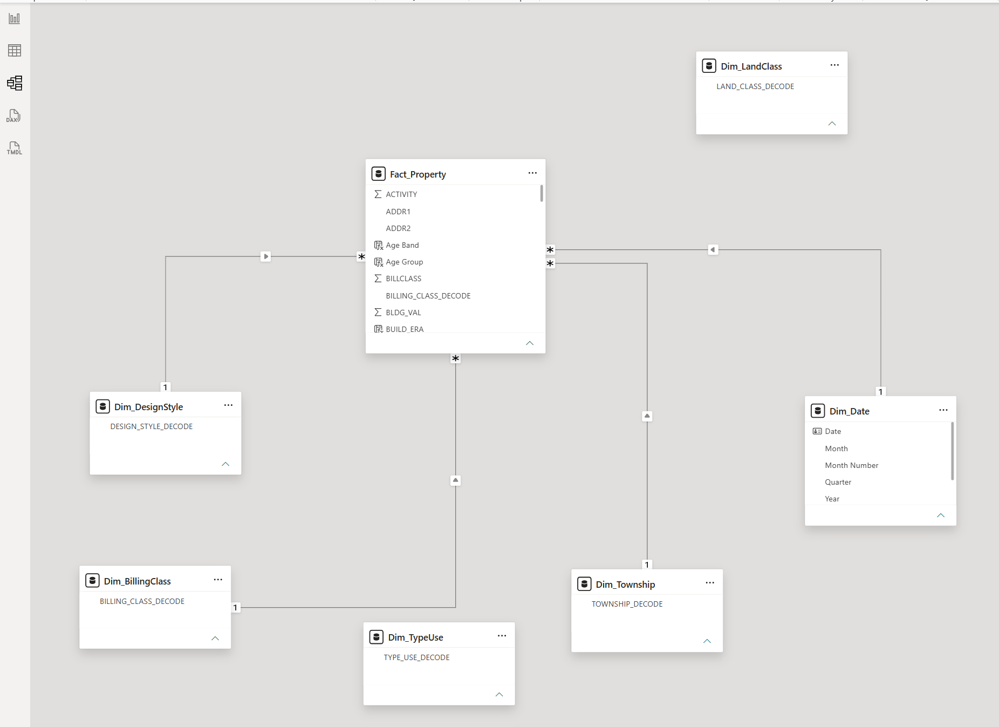
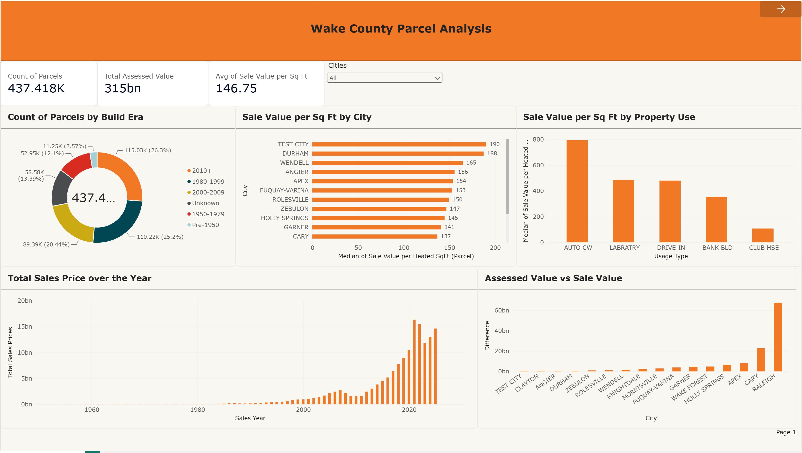
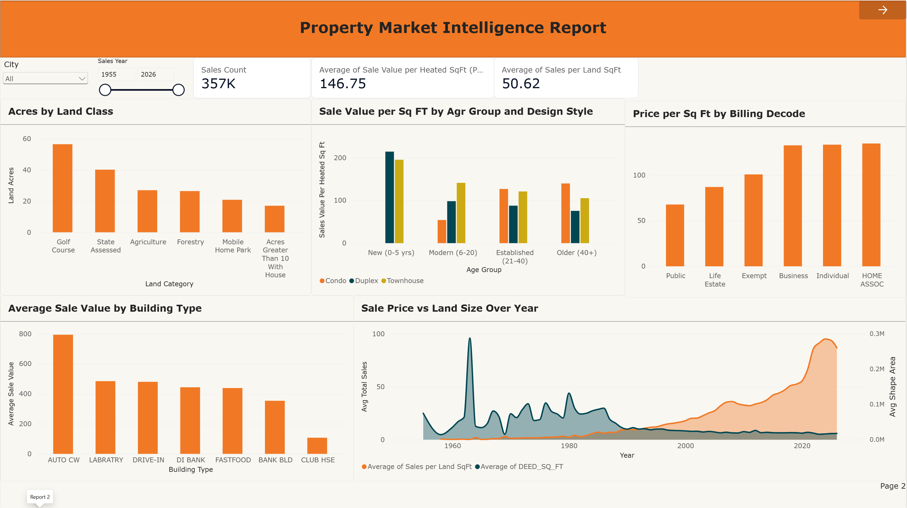
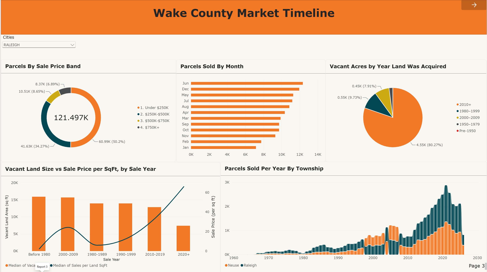
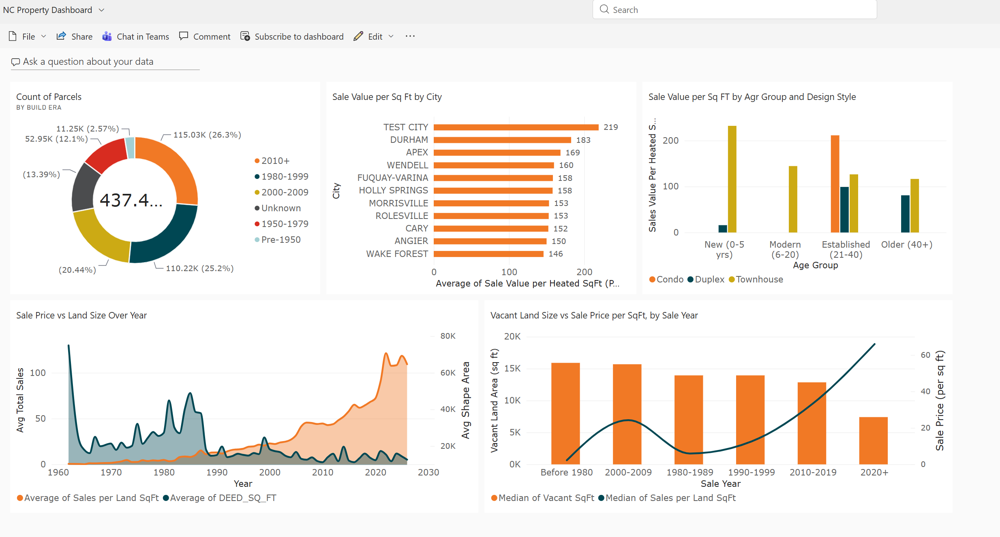
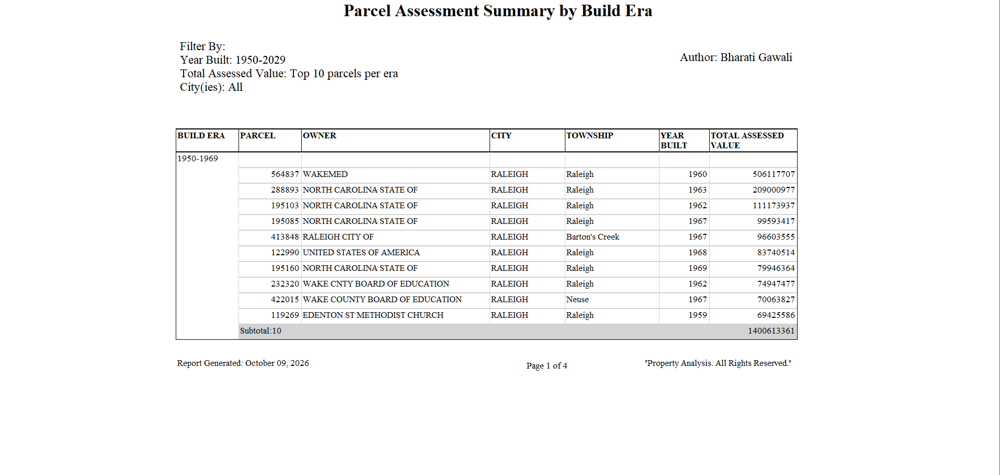
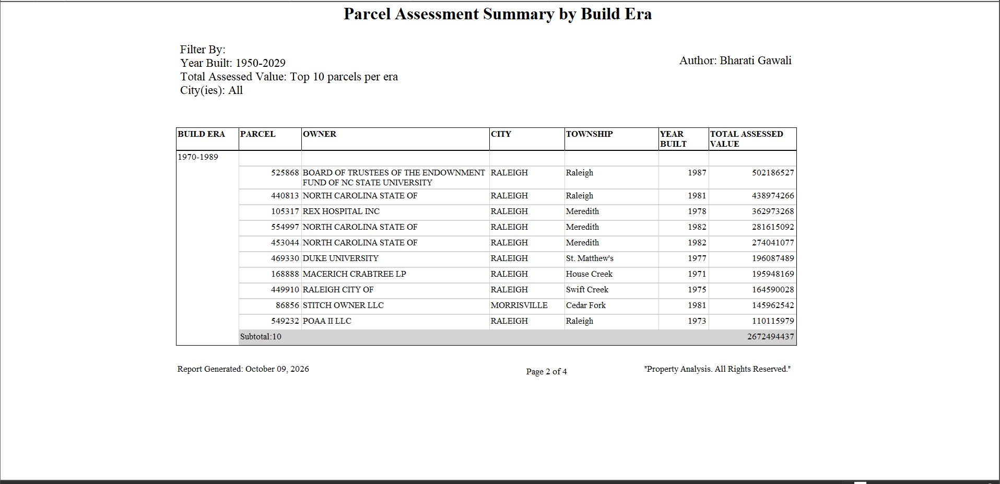
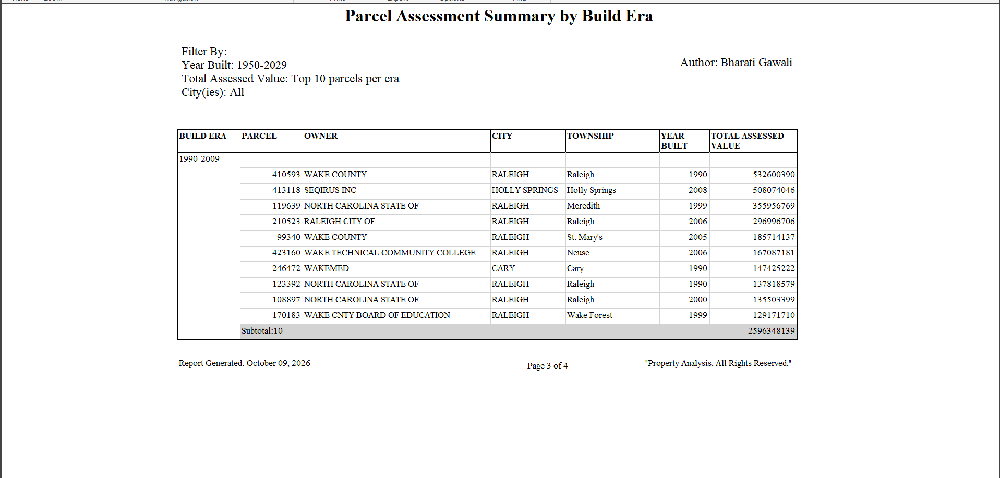
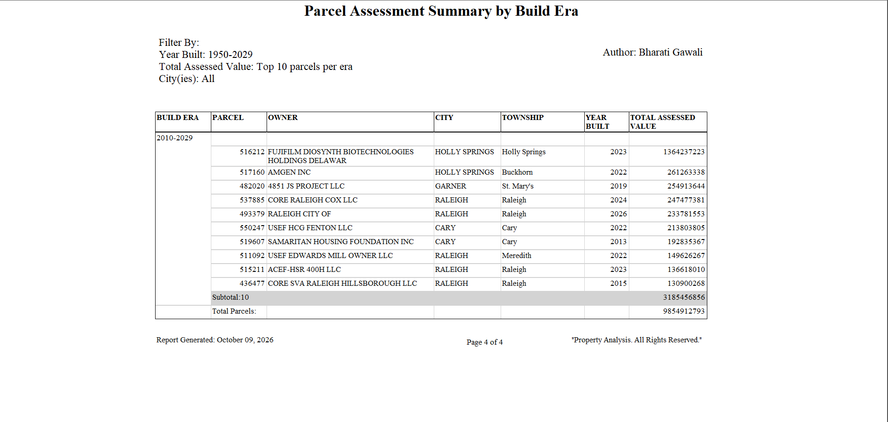

# Wake County Parcel Analysis: Power BI Project

An end-to-end Power BI project built on the **North Carolina Wake County parcel (property) dataset**. It covers loading the CSV, cleaning it in Power Query, a star-schema data model, three interactive reports (15 charts), a dashboard published to Power BI Service, a paginated report built in Power BI Report Builder, and incremental loading of new parcel files.


---

## Contents

1. [Introduction to the dataset](#1-introduction-to-the-dataset)
2. [Loading the CSV and first-time transformations](#2-loading-the-csv-and-first-time-transformations)
3. [Data model: fact and dimension tables](#3-data-model-fact-and-dimension-tables)
4. [Power BI reports (3 reports, 15 charts)](#4-power-bi-reports-3-reports-15-charts)
5. [Dashboard in Power BI Service](#5-dashboard-in-power-bi-service)
6. [Paginated report (Power BI Report Builder)](#6-paginated-report-power-bi-report-builder)
7. [Incremental loading](#7-incremental-loading)
8. [Skills demonstrated](#9-skills-demonstrated)

---

## 1. Introduction to the dataset

The data comes from the **Wake County, North Carolina parcel records**. A *parcel* is one piece of land with its own unique ID (`PARCEL_PK`). Wake County includes Raleigh, Cary, Apex, Holly Springs, Wake Forest, Garner, Wendell and other towns, so the file describes the whole county's property base.

| Item | Detail |
|---|---|
| File | `Property.csv` |
| Columns | 59 |
| Rows | About 437 thousand parcels after cleaning |
| Grain | One row per parcel |
| Key | `PARCEL_PK` |

**What each row contains**

- **Ownership:** owner name, mailing address, billing class (Business, Individual, HOA, Exempt, Public, Life Estate).
- **Location:** site address, city, township, ZIP, planning jurisdiction.
- **Land and building:** land class, type and use, design style, year built, heated area, land area (deed acres, shape area).
- **Value:** land value, building value, total assessed value (the value the county assigns for tax purposes).
- **Sale history:** deed date, sale date and total sale price.

**Key terms**

| Term | Meaning |
|---|---|
| Parcel | One piece of land with its own ID |
| Assessed value | Value set by the county for tax purposes |
| Decode column | Readable name for a code (for example `CITY_DECODE`) |
| Heated area | Living area of the building in square feet |

---

## 2. Loading the CSV and first-time transformations

### 2.1 Load

In Power BI Desktop: **Get Data → Text/CSV → select `Property.csv` → Transform Data**. This opens Power Query, where all cleaning is done before the data reaches the model.

### 2.2 Transformations applied on the first load

These steps describe the one-time initial load of the base file. (Incremental loading is covered separately in [section 7](#7-incremental-loading).)

| # | Step | Why |
|---|---|---|
| 1 | Promote the first row to headers; set `OBJECTID` and `PARCEL_PK` to whole number | Correct column names and data types for the keys |
| 2 | Sort by `PARCEL_PK` ascending and remove the top rows that have a blank `PARCEL_PK` (120 rows) | Blank keys sort to the top. Removing them makes `PARCEL_PK` a clean, non-null key |
| 3 | Remove `ADDR3`, `STPRE`, `STSUF` | Columns not needed for analysis |
| 4 | Trim whitespace on 16 text columns (owner, addresses, city, township, decode columns and others) | Stray spaces split one category into several |
| 5 | Replace blanks with `UNKNOWN` in city and in the township, type-use, design-style and land-class decode columns | Blanks get a visible label instead of an empty category |
| 6 | Split `DEED_DATE` and `SALE_DATE` into date and time, keep only the date | The time part is empty or useless |
| 7 | Set data types for about 40 columns (values, areas, years, IDs) | Needed for correct sums, medians and date logic |
| 8 | Replace empty strings with `null` in selected columns | Real nulls are handled correctly by Power BI |
| 9 | Build a clean `OLD_PARCEL_NUMBER` | Keep only values shaped like `###-#####-####`, everything else becomes null |
| 10 | Replace the placeholder deed date `9999-01-01` with null | Removes an invalid date |
| 11 | Add `OWNER_CLEAN` (upper-case letters and digits only) | Lets the same owner written in different ways be grouped together |

After the cleaning, the query is loaded and the model is built on top of it (next section).

---

## 3. Data model: fact and dimension tables

The model is a **star schema**: one fact table in the centre and dimension tables around it. Each relationship is **one-to-many**, from the dimension (one side) to the fact table (many side), with single-direction filtering.



| Table | Type | Key | Purpose |
|---|---|---|---|
| `Fact_Property` | Fact | `PARCEL_PK` | One row per parcel: values, dates, areas, year built |
| `Dim_BillingClass` | Dimension | `BILLCLASS` | Owner type: Business, Individual, HOA, Exempt, Public, Life Estate |
| `Dim_LandClass` | Dimension | `LAND_CLASS` | Land use: Residential, Vacant, HOA, Commercial, Exempt, Golf Course, Forestry and others |
| `Dim_DesignStyle` | Dimension | `DESIGNSTYL` | Home style: Conventional, Townhouse, Condo, Duplex and others |
| `Dim_TypeUse` | Dimension | `TYPE_AND_USE` | Building type: single family, bank, club house, drive-in and others |
| `Dim_Township` | Dimension | `TOWNSHIP` | Township names (Cary, Raleigh, Neuse, Wake Forest and others) |
| `Dim_Date` | Dimension (calculated table) | `Date` | Year, Quarter, Month and Month Number for the time charts |

**Relationships**

| From (one) | To (many) | Column |
|---|---|---|
| `Dim_BillingClass` | `Fact_Property` | `BILLCLASS` |
| `Dim_LandClass` | `Fact_Property` | `LAND_CLASS` |
| `Dim_DesignStyle` | `Fact_Property` | `DESIGNSTYL` |
| `Dim_TypeUse` | `Fact_Property` | `TYPE_AND_USE` |
| `Dim_Township` | `Fact_Property` | `TOWNSHIP` |
| `Dim_Date` | `Fact_Property` | `Date` → `SALE_DATE` |

**Calculated items**

| Item | Kind | Used for |
|---|---|---|
| `Dim_Date` | Calculated table | Calendar for sale-date analysis |
| `Age Group` | Calculated column | New (0-5 yrs), Modern (6-20), Established (21-40), Older (40+) |
| `Build Era` | Calculated column | Pre-1950, 1950-1979, 1980-1999, 2000-2009, 2010+, Unknown |
| `Price Band` | Calculated column | Under $250K, $250K-$500K, $500K-$750K, $750K+ |
| `Deed Period`, `Year Band` | Calculated columns | Groups years into periods for the Report 3 charts |
| `Count of Parcels` | Measure | Number of parcels |
| `Total Assessed Value` | Measure | Sum of `TOTAL_VALUE_ASSD` |
| `Median of Sale Value per Heated SqFt` | Measure | Median sale price divided by heated area |
| `Average of Sale Value per Heated SqFt` | Measure | Average price per square foot (shown on the KPI cards) |
| `Difference Assessed vs Sale Value` | Measure | Assessed value minus sale value |
| `Vacant Acres`, `Median of Vacant SqFt` | Measures | Vacant land size |

> A calculated column is computed per row and stored. A calculated table is a whole new table (here, the date table). A measure is computed on the fly and reacts to filters.

---

## 4. Power BI reports (3 reports, 15 charts)

The Power BI file has three report pages (tabs **Report 1, Report 2, Report 3**). Each report has **5 charts** plus a title banner, slicers and KPI cards, giving 15 charts in total. Each report answers a different question.

### Report 1: Wake County Parcel Analysis (county overview)

**What this report is about:** a county-wide overview of how many parcels exist, how much they are worth, and how sale value per square foot differs across eras, cities and property uses. KPI cards show **437.418K parcels**, **315bn total assessed value** and **146.75 average sale value per sq ft**. A **Cities** slicer filters the page.



**Chart 1: Count of Parcels by Build Era** (donut). Legend: Build Era, Values: Count of Parcels. Shows how the parcel base is split by construction era; 2010+ is the largest at 26.3%, followed by 1980-1999 at 25.2%.


**Chart 2: Sale Value per Sq Ft by City** (clustered bar). Y-axis: City, X-axis: Median of Sale Value per Heated SqFt. Ranks cities by price per square foot; the top values are about 190 and 188 (the "Test City" test record and Durham).


**Chart 3: Sale Value per Sq Ft by Property Use** (clustered column). X-axis: `TYPE_USE_DECODE`, Y-axis: Median of Sale Value per Heated SqFt. Compares building types; the auto car wash type is highest at about 800 and club house lowest at about 100.


**Chart 4: Total Sales Price over the Year** (clustered column). X-axis: Year, Y-axis: Sum of `TOTSALPRICE`. Shows total sales money by year; it grows slowly until about 2000 and then rises sharply, peaking around 2020.


**Chart 5: Assessed Value vs Sale Value** (clustered column). X-axis: `CITY_DECODE`, Y-axis: Difference between assessed value and sale value. Shows where the gap between county valuation and sale price is largest; Raleigh stands out at about 65bn.


---

### Report 2: Property Market Intelligence Report (land, age and type)

**What this report is about:** how land use, building age, design style and ownership type relate to price. Slicers: **City** and **Sales Year** (1955-2026). KPI cards: **Sales Count 357K**, **Average sale value per heated sq ft 146.75** and **Average sales per land sq ft 50.62**.



**Chart 1: Acres by Land Class** (clustered column). X-axis: `LAND_CLASS_DECODE`, Y-axis: Average of `DEED_ACRES`. Shows the average parcel size per land class; golf courses are the largest at about 57 acres, followed by state-assessed land.

**Chart 2: Sale Value per Sq Ft by Age Group and Design Style** (clustered column). X-axis: Age Group, Y-axis: Median of Sale Value per Heated SqFt, Legend: Design Style (Condo, Duplex, Townhouse). Shows how price per square foot changes with building age and home style; new townhouses and condos have the highest values.


**Chart 3: Price per Sq Ft by Billing Decode** (clustered column). X-axis: `BILLING_CLASS_DECODE`, Y-axis: Median of Sale Value per Heated SqFt. Compares price per square foot by owner type; Business, Individual and Home Association owners are highest at over 130.


**Chart 4: Average Sale Value by Building Type** (clustered column). X-axis: `TYPE_USE_DECODE`, Y-axis: Median of Sale Value per Heated SqFt, Tooltip: Sales Count. Shows which building types sell for the most per square foot; auto car wash is highest at about 800.

**Chart 5: Sale Price vs Land Size Over Year** (area chart, secondary axis). X-axis: Year, Y-axis: Average of Sales per Land SqFt, Secondary y-axis: Average of `DEED_SQ_FT`. Compares price per land square foot with land size over time; prices climb strongly after 2010 while typical land size shrinks.

---

### Report 3: Wake County Market Timeline (sales activity over time)

**What this report is about:** when parcels sell, at what price and how vacant land behaves over time. A **Cities** slicer (set to RALEIGH in the screenshots) filters the page.



**Chart 1: Parcels By Sale Price Band** (donut). Legend: Price Band, Values: Count of Parcels. Splits 121.497K sales into four price groups; Under $250K is the largest at 50.2%, then $250K-$500K at 34.27%.

**Chart 2: Parcels Sold By Month** (bar). Y-axis: Month, X-axis: Count of Parcels. Shows seasonality in sales; June is the busiest month and January the quietest.

**Chart 3: Vacant Acres by Year Land Was Acquired** (pie). Legend: Deed Period, Values: Vacant Acres. Shows when today's vacant land was acquired; 80.27% was acquired in 2010 or later.

**Chart 4: Vacant Land Size vs Sale Price per SqFt, by Sale Year** (line and column combo). X-axis: Year Band, Column: Median of Vacant SqFt, Line: Median of Sales per Land SqFt. Shows that vacant lots get smaller over the decades while price per square foot rises, especially after 2010.

**Chart 5: Parcels Sold Per Year By Township** (stacked area). X-axis: Year, Y-axis: Count of Parcels, Legend: Township Decode. Shows sales volume by township over time; volume peaks at about 3,000 sales a year around 2020.

---

## 5. Dashboard in Power BI Service

From the 15 report charts, **5 were pinned** to a dashboard named **NC Property Dashboard**, published to Power BI Service. A dashboard puts the most important visuals from different reports on one screen for a quick executive view. Tiles are live snapshots that link back to their source report, and the dashboard supports sharing, comments, subscriptions and the "Ask a question about your data" Q&A box.



**Why these 5 charts**

Each one covers a different business question, so the dashboard tells a complete story without repetition:

| Tile | Source | Question it answers |
|---|---|---|
| Count of Parcels by Build Era | Report 1 | How old is the property base? (composition) |
| Sale Value per Sq Ft by City | Report 1 | Where is property most expensive? (geography) |
| Sale Value per Sq Ft by Age Group and Design Style | Report 2 | Which age and style of home carries the highest price per square foot? (segment) |
| Sale Price vs Land Size Over Year | Report 2 | How have prices and land sizes moved over time? (trend) |
| Vacant Land Size vs Sale Price per SqFt, by Sale Year | Report 3 | How are vacant lots changing in size and price? (land market) |

**What the dashboard tells us**

- Parcels are spread fairly evenly across build eras, with 2010+ and 1980-1999 each holding about a quarter of the county.
- Price per square foot is highest in a few towns and varies across cities, with newer townhouses and condos priced highest.
- Over time, sale price per land square foot rises sharply after 2010 while land size per sale falls, and vacant lots show the same pattern: smaller lots at higher prices.

---

## 6. Paginated report (Power BI Report Builder)

**File:** `Parcel_static_report.rdl`  **Title:** *Parcel Assessment Summary by Build Era*
**Data source:** the published Power BI semantic model, queried with DAX.

### Why a paginated report

A Power BI report is interactive and screen-based. A paginated report is **fixed-layout and print-ready**: every row is listed, pages break cleanly, and it exports to PDF, Excel or Word. It suits formal, auditable lists that are printed or emailed.

### Layout

- **Header:** report title, filter description (Year Built 1950-2029, top 10 parcels per era, City: All) and author.
- **Body:** a table with Build Era, Parcel, Owner, City, Township, Year Built and Total Assessed Value.
- **Grouping:** rows are grouped by Build Era with a page break, so each era is on its own page.
- **Totals:** a subtotal row for each era and a grand total at the end.
- **Footer:** report generated date, page number ("Page X of Y") and copyright text.

### Pages

| Page | Era | Largest parcel | Era subtotal |
|---|---|---|---|
| 1 | 1950-1969 | WakeMed, 1960, 506,117,707 | 1,400,613,361 |
| 2 | 1970-1989 | NC State University endowment fund, 1987, 502,186,527 | 2,672,494,437 |
| 3 | 1990-2009 | Wake County, 1990, 532,600,390 | 2,596,348,139 |
| 4 | 2010-2029 | Fujifilm Diosynth Biotechnologies, 2023, 1,364,237,223 | 3,185,456,856 |

Grand total across the four eras: **9,854,912,793**.






### Why the results look like this

- The biggest parcels belong to institutions: the State of NC, Wake County, universities, hospitals (WakeMed, Rex), school boards and the City of Raleigh.
- The 2010-2029 era has the highest subtotal, driven by one large biotech facility in Holly Springs (about 1.36bn).
- The 1950-1969 era has the lowest subtotal because older buildings carry lower assessed values.

### How the DAX query works

1. Filter `Property` to year built 1950-2029, assessed value above 0, and non-blank, non-`UNKNOWN`/`UNKOWN` city and township.
2. Create `BUILD_ERA` with `SWITCH` into four eras.
3. `GENERATE` loops through the four eras and `TOPN(10, ...)` keeps the 10 highest-value parcels in each, with `PARCEL_PK` as a tie-breaker.
4. Return the seven report columns. The full query is in [Appendix B](#appendix-b-paginated-report-dax-query).

---

## 7. Incremental loading

### The idea

After the first load, new parcels arrive as extra CSV files. Instead of reloading and rebuilding everything by hand, the Power Query script **appends the new files to the base file** and keeps a single, latest row for every parcel. The model and the reports are not changed; a refresh picks up the new data.

### Source files

| Priority | File | Role |
|---|---|---|
| 1 | `Property.csv` | Base file (first-time load) |
| 2 | `Property_new_5_rows.csv` | First increment: 5 new or changed rows |
| 3 | `Property_new_parcels.csv` | Second increment: new parcels |
| 3 | `Property_incremental_next18_distinct_rows.csv` | Third increment: 18 distinct rows |

### How it works

1. Each file is read with the same 59-column layout and its headers are promoted.
2. A `SourcePriority` column is added to each file (1 for the base, higher numbers for newer files).
3. All files are combined with `Table.Combine`.
4. `OBJECTID` and `PARCEL_PK` are converted to whole numbers and rows with a blank `PARCEL_PK` are removed.
5. Rows are sorted by `SourcePriority` descending, so the newest file comes first.
6. `Table.Buffer` freezes that sort order in memory.
7. `Table.Distinct` on `PARCEL_PK` keeps the **first** row for each parcel, which is the one from the newest file. A parcel that appears in both the base file and an increment therefore gets the updated values, and a brand-new parcel is simply added.
8. `SourcePriority` is removed and the same cleaning steps from [section 2](#22-transformations-applied-on-the-first-load) run on the combined result.

```powerquery
Combined = Table.Combine({BasePriority, NewPriority, NewPriority2, NewPriority3}),

SortedByPriority = Table.Sort(RemovedBlankIDs, {{"SourcePriority", Order.Descending}}),
BufferedRows     = Table.Buffer(SortedByPriority),

RemovedDuplicateIDs = Table.Distinct(BufferedRows, {"PARCEL_PK"}),
RemovedPriority     = Table.RemoveColumns(RemovedDuplicateIDs, {"SourcePriority"})
```

### Why `Table.Buffer` matters

Without it, Power Query may re-evaluate the sort lazily and `Table.Distinct` can keep an older row. Buffering guarantees that the highest-priority row wins.

### Adding the next increment

1. Save the new file in the same folder with the same 59 columns.
2. Add a block in the query that reads it and gives it the next `SourcePriority`.
3. Add it to the `Table.Combine` list.
4. Click **Refresh**.


## 9. Skills demonstrated

Data cleaning and profiling, Power Query M, incremental append and de-duplication, star-schema modelling, DAX (calculated table, columns, measures), chart selection, report design, Power BI Service publishing, and paginated reporting with Report Builder.

---

## Appendix C: Image file name checklist

Create an `images/` folder next to this README and save each screenshot with these names.

| File name | Screenshot |
|---|---|
| `data_model.png` | Model view showing fact and dimension tables |
| `report1_page.png` | Report 1 full page |
| `report1_chart1_build_era_donut.png` | Report 1, Count of Parcels by Build Era |
| `report1_chart2_sale_value_by_city.png` | Report 1, Sale Value per Sq Ft by City |
| `report1_chart3_sale_value_by_property_use.png` | Report 1, Sale Value per Sq Ft by Property Use |
| `report1_chart4_total_sales_price_year.png` | Report 1, Total Sales Price over the Year |
| `report1_chart5_assessed_vs_sale_value.png` | Report 1, Assessed Value vs Sale Value |
| `report2_page.png` | Report 2 full page |
| `report2_chart1_acres_by_land_class.png` | Report 2, Acres by Land Class |
| `report2_chart2_age_group_design_style.png` | Report 2, Sale Value per Sq Ft by Age Group and Design Style |
| `report2_chart3_price_by_billing.png` | Report 2, Price per Sq Ft by Billing Decode |
| `report2_chart4_avg_sale_value_building_type.png` | Report 2, Average Sale Value by Building Type |
| `report2_chart5_price_vs_land_size.png` | Report 2, Sale Price vs Land Size Over Year |
| `report3_page.png` | Report 3 full page |
| `report3_chart1_price_band_donut.png` | Report 3, Parcels By Sale Price Band |
| `report3_chart2_parcels_sold_by_month.png` | Report 3, Parcels Sold By Month |
| `report3_chart3_vacant_acres_by_year.png` | Report 3, Vacant Acres by Year Land Was Acquired |
| `report3_chart4_vacant_size_vs_price.png` | Report 3, Vacant Land Size vs Sale Price per SqFt |
| `report3_chart5_parcels_sold_per_year_township.png` | Report 3, Parcels Sold Per Year By Township |
| `dashboard.png` | NC Property Dashboard in Power BI Service |
| `paginated_page1.png` to `paginated_page4.png` | Paginated report pages 1 to 4 |
